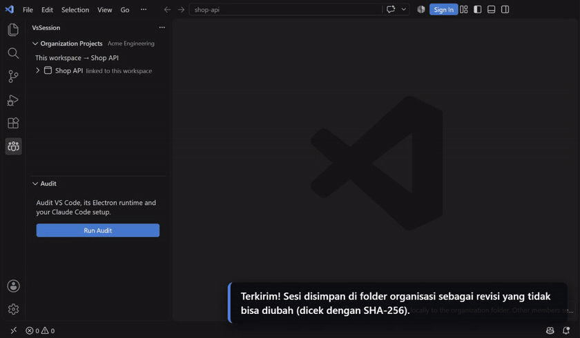
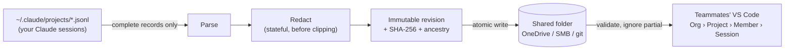

<div align="center">

# VsSession

**Share Claude Code sessions with your whole team, and audit your VS Code setup while you're at it.**

[](https://github.com/Keanw234412/vssession/actions/workflows/ci.yml)
[](LICENSE)
[](https://code.visualstudio.com/)
[](package.json)
[](CONTRIBUTING.md)

[English](README.md) · [Bahasa Indonesia](README.id.md)

</div>

---

Your teammate solved the exact bug you're stuck on, in a Claude Code session, yesterday. That session lives in their `~/.claude/projects` folder, and you can't see it.

**VsSession** fixes that. Point it at any folder your team already shares (OneDrive, SharePoint, a network drive, a git repo). Every member then gets a live, read-only view of everyone's Claude sessions, organized as **Organization → Project → Member → Session**. Nobody has to run a server or create an account, and secrets are redacted before anything leaves your machine.

It also includes a **security audit** of your VS Code + Claude Code setup. The audit came out of reverse-engineering the shipped binaries, and it offers one-click, verified, undoable fixes.

[](docs/demo.mp4)

▶️ **[Watch the full 4-minute tutorial](docs/demo.mp4)** (Indonesian captions): creating an organization, sharing a session, a teammate joining, and the audit with safe fixes.

## ✨ Features

### 👥 Organization Projects: team-wide Claude sessions
- **Together and separate.** Every member's sessions are kept apart, and everyone in the org can browse all of them.
- **Live follow.** An open transcript updates as your teammate keeps working.
- **Share manually or automatically.**
  - *Manual:* a preview shows exactly what will be shared and where it goes.
  - *Automatic:* turned on per workspace, after explicit consent.
- **Redaction before sharing.** Private keys (including keys split across messages), API tokens (Anthropic, OpenAI, GitHub, GitLab, Slack, Stripe, Google, AWS, npm, Hugging Face), JWTs, auth headers, URL credentials, `PASSWORD=`-style assignments, structured `{ "password": … }` fields, e-mails, phone numbers (+country, Indonesian 08…/628…), WhatsApp and Telegram ids, home paths, your OS user name and your Claude account UUIDs are all removed.
- **Git branch as the shared folder.** Keep the organization on a dedicated branch of the repo your team already uses (checked out as a git worktree). VsSession pulls every minute and commits + pushes after each share, retrying once after a rebase. It never force-pushes and refuses to touch a folder that is part of a code checkout.
- **Safe on sync folders.**
  - Each device writes only to its own folder, so sync clients never see conflicting writes.
  - Each published version is an immutable file with a content hash; half-synced files are ignored and the last valid version stays visible.
  - Versions are ordered by causal ancestry, not wall clocks, so a wrong clock can't hide newer work.
  - If two devices share the same session while offline, both versions are shown as a conflict.
- **Hostile-input hardened.**
  - Every path segment is validated, and the extension refuses to write through symlinks or junctions.
  - Shared content is checked against a strict schema.
  - Transcripts render in a webview with **no scripts** (`default-src 'none'`).

### 🛡️ Audit: VS Code & Claude Code hardening
| Check | What it finds | Fix |
|---|---|---|
| Electron fuses in `Code.exe` | `RunAsNode`, `NODE_OPTIONS`, `--inspect` enabled; ASAR integrity off on a user-writable install | Report-only, with an explanation (VS Code needs some of these) |
| Security settings | Workspace Trust off, automatic tasks, agent tools auto-approved, protocol-handler prompts off, proxy TLS validation off, unsigned extensions | One click: re-reads the value afterwards, can be undone, and respects policy/workspace scope |
| Claude Code | `bypassPermissions` defaults, `Bash(*)` allow rules, custom process wrapper, secrets in `claudeCode.environmentVariables` | Opens the file to review |
| Windows long paths | Claude session paths > 260 chars that PowerShell/Explorer can't open | Copies the admin command; `git core.longpaths` fix |

The full write-up is in [AUDIT.md](AUDIT.md). Every finding is labelled as observed, inferred or unknown.

## 🚀 Quick start

```bash
# grab the latest .vsix from Releases, then:
code --install-extension vssession-0.2.0.vsix
```

1. Open the **VsSession** icon in the Activity Bar.
2. **Audit → Run Audit** to see how your setup scores.
3. **Organization Projects → Create Organization** and pick a folder your team already shares.
4. Open your project, run **Link This Workspace**, then **Share a Claude Session**.
5. Teammates run **Open Existing Organization** on the same folder. Their sessions and yours show up side by side.

### Share through a branch of your existing repo

```bash
# once, by whoever sets it up (inside your project clone)
git worktree add --orphan -b vssession ../myproject-vssession
# everyone else
git fetch origin vssession && git worktree add ../myproject-vssession vssession
```

Point **Create Organization** (first member) or **Open Existing Organization** (everyone else) at `../myproject-vssession`. Add a `.gitattributes` with `* -text` there so revision files stay byte-identical on every OS. Sync status sits in the status bar; click it to sync now.

## 🧠 How it works



```
<root>/org.json
<root>/projects/<projectId>/members/<memberId>/devices/<deviceId>/sessions/<sessionId>/rev-<seq>-<rand>.json
```

**Access control is the folder's sharing settings.** Anyone who can read the folder can read the sessions in it. Display names are self-reported. These limits are documented on purpose and are not hidden.

## 🧪 Development

```bash
npm install
npm test          # tsc + node:test suite (no VS Code needed)
npm run package   # builds the .vsix
```

`src/core/` is pure TypeScript with zero dependencies on `vscode`:
- fuse reader
- redactor
- session parser
- shared-folder store
- consent logic

Each of these is unit-tested, including attack-style cases: clock skew, concurrent publishers, truncated writes, junction escapes, split private keys, tampered revisions, and more.

## 🗺️ Roadmap

- [ ] Publish to the VS Code Marketplace / Open VSX
- [ ] Search across all shared sessions
- [ ] Remote SSH / WSL support
- [ ] Optional signing of revisions (verifiable authorship)
- [ ] Markdown rendering in transcripts
- [ ] More redaction rules: [open an issue](https://github.com/Keanw234412/vssession/issues/new/choose) with a token format we miss

## 🤝 Contributing

Contributions are very welcome, whether that's new redaction rules, audit checks, translations or UI polish. See [CONTRIBUTING.md](CONTRIBUTING.md) and look for issues labelled **good first issue**.

If VsSession helps your team, please **⭐ star the repo**. It helps other people find it.

## 🔐 Security

Found a way to make secrets leak through the redactor, or to escape the shared folder? Please report it privately: see [SECURITY.md](SECURITY.md).

## License

[MIT](LICENSE). Not affiliated with Anthropic or Microsoft. "Claude" and "VS Code" are trademarks of their respective owners.
